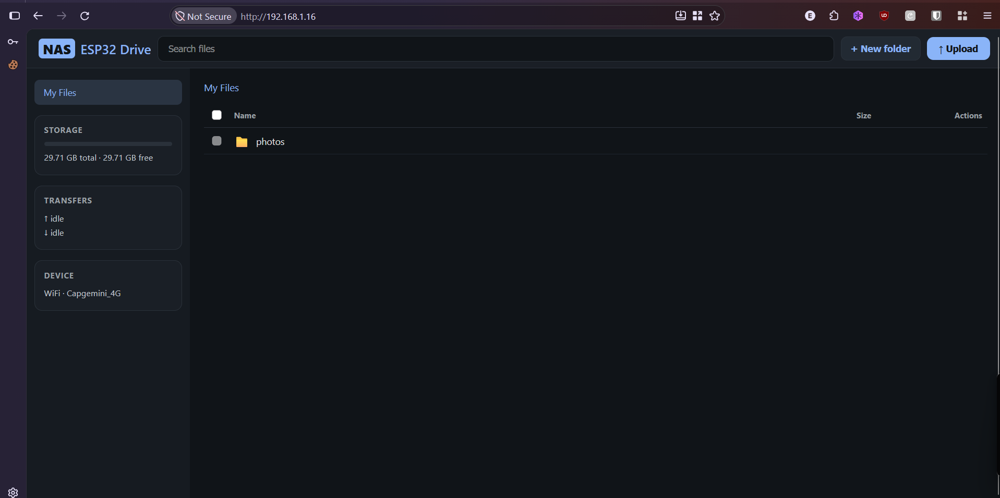

<div align="center">


<p align="center">
  <strong>Support</strong><br>
  If these projects help you, connect with us on social media:
</p>


[](https://www.youtube.com/channel/UCKKhdFV0q8CV5vWUDfiDfTw)
[](https://t.me/fusionautomate)
[](https://www.instagram.com/fusion_automate)
[](https://wa.me/919974477759)
[](https://buymeacoffee.com/pylin)
</div>

# ESP32 NAS — VIEWE 5-Inch Display

A WiFi network-attached storage (NAS) file server for the VIEWE UEDX80480050E-WB 5-inch ESP32-S3 display (800x480). Files live on the onboard microSD slot and are served over HTTP: browse, upload, download, delete, and create folders from any browser. The 5-inch screen shows a live status dashboard — IP address, WiFi state, and SD usage — and the firmware supports OTA updates once connected.

**Status — hardware tested.** This is a working port of the [CrowPanel 2.8" ESP32 NAS](https://github.com/papercodeIN/Elecrow/tree/main/CrowPanel%20-%20ESP32%20HMI%20Display%20-%202.8%20Inch/Project/ESP32_NAS) workflow to the VIEWE 5-inch display. The firmware has been flashed and tested on the VIEWE UEDX80480050E-WB: the RGB display, microSD storage, WiFi connection, web UI, AP setup flow, and OTA-ready runtime are operational. The display driver is based on the hardware-tested [Bluetooth Stream Deck](<../Bluetooth_Stream_Deck/README.md>) port; SD pins (GPIO 10/11/12/13) are taken from the VIEWE schematic TF-card section.

## Web UI

The embedded browser interface provides a drive-style file manager with folder navigation, search, uploads with progress, streamed downloads, file deletion, bulk selection, and folder creation.



The live device was tested at `http://192.168.1.16`. The screenshot above shows the web UI with the `photos` folder and approximately 29.71 GB of free microSD storage.

The firmware is tested over the CH340C serial port at 115200 baud. Keep the serial monitor open during future changes so display, SD, WiFi, and upload diagnostics remain visible.

### Verified Hardware Status

- RGB display boots reliably with the VIEWE-specific OPI-PSRAM board definition.
- microSD storage, WiFi, mDNS, the web UI, AP setup, and OTA readiness have been tested on the display.
- Photo uploads have been verified from both an Android phone and a Windows laptop.
- The responsive mobile layout keeps storage, transfer, WiFi, and device information available above the file list.
- Uploads are buffered in PSRAM and support files up to 6 MB; larger files are rejected to protect runtime memory.

## What You Need

- VIEWE UEDX80480050E-WB 5-inch ESP32-S3 (N16R8: 16 MB flash + 8 MB PSRAM)
- A microSD card, **FAT32-formatted**, inserted in the slot on the back (an 8 GB card works well; exFAT is NOT supported by the ESP32 SD library)
- USB-C data cable connected to the CH340C port for flashing and serial monitor
- PlatformIO Core or the PlatformIO IDE extension for VS Code

Ported from and tested against:

- PlatformIO `espressif32@6.9.0` (Arduino-ESP32 core 2.0.17)
- GFX Library for Arduino `1.4.7` (RGB panel driver)
- ESPAsyncWebServer `3.6.0` + AsyncTCP `3.3.2` (ESP32Async fork)

## Features

- **Web file manager** — single-page app served from firmware: browse folders, search, bulk-select, upload with progress, download (streamed, live speed), delete, create folders; responsive mobile layout keeps storage, transfer, WiFi, and device status visible above the file list
- **WiFi setup portal** — on first boot (or AP fallback) the device opens `NAS-Setup` and serves the same UI with a WiFi form; captive DNS redirects
- **5-inch status dashboard** — IP, SSID, total/used/free GB, usage bar, OTA indicator; redraws only on state change (no flicker)
- **AP fallback** — if the saved WiFi is unreachable, falls back to an open access point after 10 non-blocking retries
- **OTA updates** — two 6.4 MB app slots in the 16 MB flash; update over WiFi via PlatformIO
- **mDNS** — reach the device at `http://viewe-nas.local` (browsers that support mDNS)
- **SD hot-plug recovery** — card removal/mount failure shows a fault screen and retries every 5 s; SPI clock auto-downgrades to 4 MHz after repeated mount failures
- **NVS credential storage** — WiFi settings persist across reboots via Preferences
- **secrets.h support** — optional default WiFi credentials, gitignored
- **Path safety** — all file paths validated against `..` traversal; filenames sanitized; folder deletion refused
- **Reliable laptop/photo uploads** — multipart data is buffered in PSRAM first, then written to SD after the transfer completes; uploads are stored in the folder currently open in the browser (up to 6 MB per file)

## Improvements Over the 2.8" Original

- Per-request upload verdicts (a rejected parallel upload can no longer flip a good upload's HTTP result)
- Abandoned-upload watchdog: stalled PSRAM-buffered uploads are released (60 s stall timeout); final SD writes are retried in 4 KB pieces
- SD access mutex between the async web task and the status poller (the original polled SD concurrently with handlers)
- `/api/list` caps the JSON at ~60 KB (folders with thousands of entries no longer risk an OOM crash; `"truncated":true` is set when capped)
- Partition table with OTA support (the original's single-slot layout could not do OTA)
- ESP32Async fork of AsyncWebServer (actively maintained; same API)

## Future Enhancements

- **Multiple simultaneous uploads** — currently one upload is accepted at a time to protect the shared PSRAM buffer and SD write path. Concurrent uploads remain a possible future enhancement using per-request buffers and a queued SD writer.

## Project Structure

```
ESP32_NAS/
├── platformio.ini              # Build config (board, libs, 15 MHz PCLK notes)
├── partitions_16mb_ota.csv     # 16 MB flash: two 6.4 MB OTA slots
├── flash.ps1                   # Windows helper: pick COM port, build + flash
├── boards/
│   └── viewe-uedx80480050e-n16r8.json   # Vendored board def (OPI PSRAM init)
├── include/
│   ├── config.h                # Pin map (schematic-verified), timings, WiFi names
│   ├── secrets.h               # WiFi creds - GITIGNORED, never committed
│   └── secrets.h.example       # Template to copy to secrets.h
├── src/
│   └── main.cpp                # Firmware (web UI embedded in PROGMEM)
├── images/
│   └── web_ui.png              # Web UI screenshot
└── README.md
```

The custom board definition uploads the application at `0x20000`, matching the OTA partition table. This alignment is required because the OTA data partition occupies `0x10000`–`0x11FFF`.

## Hardware Notes

| Function | GPIO | Source |
|----------|------|--------|
| SD CS | 10 | VIEWE schematic, TF1 pin 2 (DAT3/CS) |
| SD MOSI | 11 | VIEWE schematic, TF1 pin 3 (CMD) |
| SD SCK | 12 | VIEWE schematic, TF1 pin 5 (CLK) |
| SD MISO | 13 | VIEWE schematic, TF1 pin 7 (DATA0) |
| Backlight | 2 | `IO2-LCD-BL-EN`, PWM via LEDC |
| RGB panel | see `src/main.cpp` | Vendor board definition (ST7262, 15 MHz PCLK) |
| Touch (GT911) | SDA 19, SCL 20 | **Not used** — the status screen is display-only |

> **Why 15 MHz PCLK?** The vendor stack runs this panel at 20 MHz with an esp_lcd DMA bounce buffer. Arduino_GFX 1.4.7 has no bounce buffers, so scanout reads the PSRAM framebuffer directly; 20 MHz outruns sustainable PSRAM bandwidth once WiFi + SD traffic contend for the bus. 15 MHz is the proven-stable rate for this exact stack (see the Bluetooth Stream Deck README).

> **SD and touch share nothing.** The TF slot sits on the FSPI bus (GPIO 10-13); touch is I2C (19/20). The firmware never initialises touch or USB-CDC (`ARDUINO_USB_CDC_ON_BOOT=0` keeps the USB pins free — flashing/serial runs over the CH340C UART).

## Build & Flash

1. Install [PlatformIO Core](https://platformio.org/install/cli) or the VS Code extension
2. From this folder:

   ```bash
   pio run                    # build
   pio run --target upload    # flash over the CH340C USB-C port
   pio device monitor         # serial log at 115200
   ```

   On Windows, `flash.ps1` does the same (it lists COM ports and asks which one is the display):

   ```powershell
   powershell -ExecutionPolicy Bypass -File flash.ps1
   ```

3. First flash erases the two-slot OTA layout cleanly (otadata defaults to slot 0). No manual erase needed.

### WiFi Credentials

Either use the AP portal on first boot, or bake in default credentials:

```bash
cp include/secrets.h.example include/secrets.h
# edit include/secrets.h with your SSID and password
```

`include/secrets.h` is gitignored — your credentials stay local and are never committed. Without it, the device goes straight to AP mode on first boot.

### OTA Updates

Once the NAS is on your network:

```bash
pio run -t upload --upload-port viewe-nas.local
# or use the device IP:  pio run -t upload --upload-port 192.168.x.x
```

## First Boot & WiFi Setup

1. Insert a **FAT32** microSD card and power the board
2. On first boot the display shows **NETWORK // SETUP**:
   - Connect a phone/laptop to the WiFi network **`NAS-Setup`** (open, no password)
   - Open **http://192.168.4.1** — the file manager loads with a WiFi Setup card
   - Enter your home SSID + password → **Save & Connect** → the board reboots
3. The display switches to the **NAS // NODE 01** dashboard; find the IP in the big IP row (or try `http://viewe-nas.local`)
4. Open the IP in a browser → **My Files** file manager

### Display Screens

| Screen | When | Content |
|--------|------|---------|
| `NAS // NODE 01` | SD mounted + WiFi connected | SSID, IP, host name, total/used/free GB, usage bar, web URL, OTA badge |
| `NETWORK // SETUP` | No credentials or AP fallback | AP SSID, open-network note, portal URL, SD status |
| `STORAGE // FAULT` | SD missing / mount failed | Warning panel, recovery steps, live attempt/elapsed counters, animated agent dots |

## Web API

| Path | Method | Description |
|------|--------|-------------|
| `/` | GET | File manager SPA (WiFi form appears in AP mode) |
| `/api/status` | GET | SD mount state, GB total/free, WiFi/AP state, SSID, IP, hostname |
| `/api/list?dir=/path` | GET | Directory listing JSON (folders first in the UI; ~60 KB cap with `truncated` flag) |
| `/api/mkdir` | POST | Create folder (`dir`, `name`) |
| `/upload?dir=/path` | POST | Multipart upload to the selected directory (one file per request) |
| `/download?file=/path` | GET | Stream a file as an attachment |
| `/delete?file=/path` | GET | Delete a file (folders refused) |
| `/setwifi` | POST | Save WiFi credentials (AP mode only, reboots) |

Uploads land in the directory you are browsing; subfolder navigation is supported for browsing, upload, and download.

## Serial Log

```
=== VIEWE 5" NAS - Starting ===
[DISPLAY] RGB panel ready (800x480, PCLK 15 MHz, PSRAM framebuffer)
[SD] Mounted OK - Total: 7.55 GB, Free: 7.41 GB
[WIFI] Connected! IP: 192.168.1.42
[MDNS] http://viewe-nas.local
[OTA] Ready - upload via PlatformIO or Arduino IDE OTA
[HTTP] Web server started (ESP32 Drive UI)
=== Setup complete ===
```

During a successful photo upload, the upload section reports `Done (success=1)` after the complete multipart transfer has been buffered and written to the microSD card.

## Troubleshooting

**Display stays black:**
- Confirm the vendored board (`viewe-uedx80480050e-n16r8`) is used — the stock ESP32-S3 dev board definition does not initialise OPI PSRAM and the RGB framebuffer allocation fails
- Serial shows `[FATAL] PSRAM not detected` if the board variant is wrong

**SD card not detected:**
- Card must be FAT32 (exFAT/NTFS will not mount)
- The fault screen retries every 5 s; after 3 failures the SPI clock drops to 4 MHz automatically (watch serial for `[SD] Downgrading SPI clock`)
- Serial shows `[SD] Mount FAILED` and the display shows `STORAGE // FAULT`

**WiFi shows LINKING for a long time:**
- Connection attempt times out after 60 s, then falls back to AP mode
- Wrong saved credentials: erase NVS (`esptool.py erase_region 0x9000 0x6000`) and reboot — the device returns to AP setup

**Upload fails:**
- Serial shows the reason (`SD busy`, `invalid filename`, `PSRAM buffer allocation failed`, or `SD write failed`)
- Only one upload at a time is accepted; a second parallel upload is rejected until the first finishes
- Uploads are buffered in PSRAM before the SD write; if a browser disconnects between chunks, the buffer is released after the 60-second timeout

**OTA upload fails:**
- OTA needs both app slots healthy — after a failed OTA, plain USB re-flash restores a clean state
